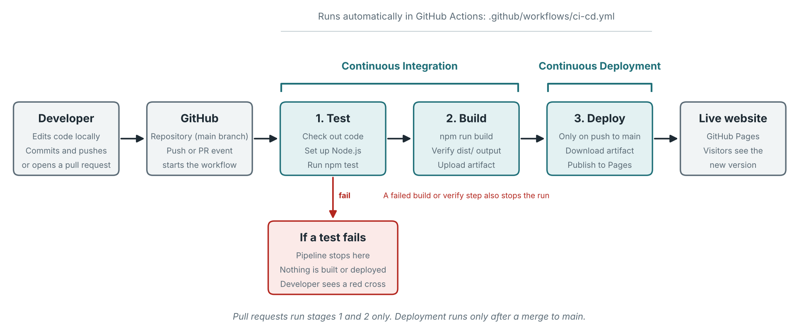

# Harbor & Pine Studio: website with a CI/CD pipeline

A small static website whose every change is tested, built and published automatically by GitHub Actions.



## Project structure

```
cicd-website/
├── .github/workflows/ci-cd.yml   the pipeline (test, build, deploy)
├── src/                          website source (HTML, CSS, JavaScript)
├── scripts/
│   ├── build.js                  copies src/ to dist/ and stamps the build version
│   ├── verify-build.js           checks dist/ is complete before deployment
│   └── serve.js                  local preview server
├── tests/site.test.js            automated tests (Node's built-in test runner)
├── docs/workflow-diagram.png     pipeline diagram
└── package.json                  npm scripts; no external dependencies
```

## Run locally

Requires Node.js 20 or newer.

```
npm test         # run the automated tests
npm run build    # create dist/
npm run verify   # check the build output
npm start        # preview at http://localhost:8080
```

## How the pipeline works

| Event | Test | Build | Deploy |
|---|---|---|---|
| Pull request into `main` | runs | runs | skipped |
| Push or merge to `main` | runs | runs | runs |

Each job runs only if the previous one succeeded. A failing test stops the run, so broken code is never published.

## Publish on GitHub Pages

1. Create a public GitHub repository and push this folder to its `main` branch.
2. In the repository open **Settings > Pages** and set **Source** to **GitHub Actions**.
3. Push any change. The **Actions** tab shows the run, and the site URL appears on the deploy job.

The footer of the live site shows the commit that was deployed.
